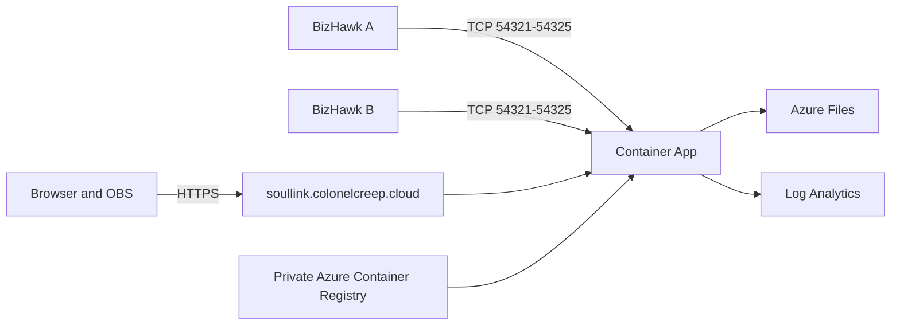

# Deploy Auto-SoulLink to Azure Container Apps

This deployment runs one stateful SLink Manager in Azure Container Apps. The Manager supervises up to five simultaneous run-server child processes inside the same container.



> [!WARNING]
> Browser and administrator traffic uses HTTPS. BizHawk telemetry uses Auto-SoulLink's existing plaintext TCP protocol. Instrumentation keys identify a run/player source but are visible in transit and must not be treated as confidential authentication.

## Resources

`infra/main.bicep` provisions:

- A `/27` virtual-network subnet delegated to Azure Container Apps. A custom VNet is required for external TCP ingress.
- A Log Analytics workspace with 30-day retention.
- A StorageV2 account, SMB Azure file share and seven-day deleted-share retention.
- A user-assigned managed identity attached to the Container App.
- A private Basic Azure Container Registry with `AcrPull` granted to the managed identity.
- A Consumption workload-profile Container Apps environment connected to the VNet, Log Analytics and Azure Files.
- One single-revision Container App with exactly one replica, Manager HTTPS ingress on `8090`, and external TCP ports `54321` through `54325`.

Azure Files shared-key access is deliberately enabled. Container Apps environment storage currently requires the storage account key and does not support identity-based Azure Files mounts. Public blob access remains disabled and the account requires HTTPS with TLS 1.2.

`infra/domain.bicep` creates the Azure DNS CNAME and `asuid` TXT validation records in the existing `colonelcreep.cloud` zone and requests a free Container Apps managed certificate. Azure requires the custom hostname to be registered on the Container App before it will issue the certificate, so domain setup uses a separate hostname-registration step before this template.

## Prerequisites

1. An Azure subscription with permission to create resource-group resources and write records in the existing Azure DNS zone.
2. Azure CLI with Bicep CLI installed:

   ```powershell
   az version
   az bicep upgrade
   az bicep version
   ```

3. Register the required providers once per subscription:

   ```powershell
   az provider register --namespace Microsoft.App
   az provider register --namespace Microsoft.OperationalInsights
   az provider register --namespace Microsoft.Storage
   az provider register --namespace Microsoft.Network
   az provider register --namespace Microsoft.ManagedIdentity
   az provider register --namespace Microsoft.ContainerRegistry
   ```

4. Create or choose the target resource group. The Bicep templates are resource-group scoped.
5. Confirm that Container Apps, Container Registry, Storage, Log Analytics, networking and managed identities are available in East US 2 for the target subscription.

## Validate the templates

```powershell
az bicep build --file .\infra\main.bicep
az bicep build --file .\infra\domain.bicep
```

Keep the administrator key outside the repository:

```powershell
$resourceGroup = 'autoSoulLink-resourceGroup-prod'
$adminKey = Read-Host 'Administrator key' -MaskInput
```

## Phase 1: deploy the base resources and build the image

The first deployment omits the Container App because its private registry does not contain an image yet:

```powershell
az deployment group what-if `
  --name 'auto-soullink-base' `
  --resource-group $resourceGroup `
  --template-file .\infra\main.bicep `
  --parameters .\infra\main.parameters.json `
  --parameters adminKey=$adminKey deployApp=false

$base = az deployment group create `
  --name 'auto-soullink-base' `
  --resource-group $resourceGroup `
  --template-file .\infra\main.bicep `
  --parameters .\infra\main.parameters.json `
  --parameters adminKey=$adminKey deployApp=false `
  --output json | ConvertFrom-Json

$registryName = $base.properties.outputs.containerRegistryName.value
$registryServer = $base.properties.outputs.containerRegistryLoginServer.value
$commit = git rev-parse HEAD
$image = "$registryServer/auto-soullink:$commit"

az acr build `
  --registry $registryName `
  --image "auto-soullink:$commit" `
  --image 'auto-soullink:latest' `
  .
```

ACR Tasks builds remotely, so this works without a local Docker engine. Use the immutable commit tag for deployments; `latest` is only a convenience tag.

Preview every infrastructure change, then deploy the app:

```powershell
az deployment group what-if `
  --name 'auto-soullink-core' `
  --resource-group $resourceGroup `
  --template-file .\infra\main.bicep `
  --parameters .\infra\main.parameters.json `
  --parameters adminKey=$adminKey containerImage=$image

$core = az deployment group create `
  --name 'auto-soullink-core' `
  --resource-group $resourceGroup `
  --template-file .\infra\main.bicep `
  --parameters .\infra\main.parameters.json `
  --parameters adminKey=$adminKey containerImage=$image `
  --output json | ConvertFrom-Json

$environmentName = $core.properties.outputs.containerEnvironmentName.value
$appFqdn = $core.properties.outputs.containerAppFqdn.value
$verificationId = $core.properties.outputs.customDomainVerificationId.value
```

Verify the default endpoint before configuring DNS:

```powershell
Invoke-RestMethod "https://$appFqdn/healthz"
Invoke-RestMethod "https://$appFqdn/readyz"
```

If the first Container App revision fails to pull immediately after the `AcrPull` role assignment, wait for Azure RBAC propagation and rerun the unchanged core deployment.

## Phase 2: register the hostname

Azure will not issue a managed certificate until the hostname exists on a Container App in the environment. Register it with TLS disabled first:

```powershell
az deployment group what-if `
  --name 'auto-soullink-hostname' `
  --resource-group $resourceGroup `
  --template-file .\infra\main.bicep `
  --parameters .\infra\main.parameters.json `
  --parameters `
    adminKey=$adminKey `
    containerImage=$image `
    registerCustomDomain=true

az deployment group create `
  --name 'auto-soullink-hostname' `
  --resource-group $resourceGroup `
  --template-file .\infra\main.bicep `
  --parameters .\infra\main.parameters.json `
  --parameters `
    adminKey=$adminKey `
    containerImage=$image `
    registerCustomDomain=true
```

## Phase 3: create DNS and request the certificate

The Azure DNS zone may live in another resource group or subscription. Supply both scopes when needed:

```powershell
$dnsResourceGroup = 'rg-dns'
$dnsSubscription = (az account show --query id --output tsv)

az deployment group what-if `
  --name 'auto-soullink-domain' `
  --resource-group $resourceGroup `
  --template-file .\infra\domain.bicep `
  --parameters `
    containerEnvironmentName=$environmentName `
    containerAppFqdn=$appFqdn `
    customDomainVerificationId=$verificationId `
    dnsZoneResourceGroup=$dnsResourceGroup `
    dnsZoneSubscriptionId=$dnsSubscription

$domain = az deployment group create `
  --name 'auto-soullink-domain' `
  --resource-group $resourceGroup `
  --template-file .\infra\domain.bicep `
  --parameters `
    containerEnvironmentName=$environmentName `
    containerAppFqdn=$appFqdn `
    customDomainVerificationId=$verificationId `
    dnsZoneResourceGroup=$dnsResourceGroup `
    dnsZoneSubscriptionId=$dnsSubscription `
  --output json | ConvertFrom-Json

$certificateId = $domain.properties.outputs.managedCertificateId.value
```

If certificate issuance initially reports pending DNS validation, wait until the records resolve publicly and rerun the domain deployment:

```powershell
Resolve-DnsName soullink.colonelcreep.cloud -Type CNAME
Resolve-DnsName asuid.soullink.colonelcreep.cloud -Type TXT
```

Bind the issued certificate by previewing and redeploying the main template:

```powershell
az deployment group what-if `
  --resource-group $resourceGroup `
  --template-file .\infra\main.bicep `
  --parameters .\infra\main.parameters.json `
  --parameters `
    adminKey=$adminKey `
    containerImage=$image `
    registerCustomDomain=true `
    bindCustomDomain=true `
    managedCertificateId=$certificateId

az deployment group create `
  --name 'auto-soullink-core' `
  --resource-group $resourceGroup `
  --template-file .\infra\main.bicep `
  --parameters .\infra\main.parameters.json `
  --parameters `
    adminKey=$adminKey `
    containerImage=$image `
    registerCustomDomain=true `
    bindCustomDomain=true `
    managedCertificateId=$certificateId
```

## Verify the deployment

```powershell
Invoke-RestMethod 'https://soullink.colonelcreep.cloud/healthz'
Invoke-RestMethod 'https://soullink.colonelcreep.cloud/readyz'

54321..54325 | ForEach-Object {
  Test-NetConnection soullink.colonelcreep.cloud -Port $_ |
    Select-Object RemotePort, TcpTestSucceeded
}
```

Open `https://soullink.colonelcreep.cloud/admin/login`, enter the shared administrator key, create a run and download fresh player packages. A stopped run releases its TCP port; when restarted it may receive another port, so download fresh launchers after a displayed port change.

Create five active runs and confirm that a sixth start returns the capacity message instead of binding an undeclared port. Stop one run and confirm that the waiting run can then start.

## Operations

- **Update the app:** build an immutable tag with `az acr build`, run `what-if` with `containerImage=<new tag>`, then redeploy `main.bicep` with `registerCustomDomain=true`, `bindCustomDomain=true` and the existing `managedCertificateId`. Omitting the binding parameters removes the custom-domain binding.
- **Rotate the administrator key:** generate a new value and redeploy `main.bicep`. Existing encrypted administrator cookies become invalid because their encryption key is derived from the administrator key.
- **Back up state:** use the Storage account's file-share backup or snapshot features. The mounted share contains the Manager registry, run state, event history, memorials, rolling backups and uploaded ROMs.
- **Restore state:** stop the Container App revision before replacing files, restore a consistent file-share snapshot, then restart. Desired-running runs are respawned from the restored registry.
- **Inspect logs:** query the Container App's console logs through its Log Analytics workspace. Per-run `spawn.log` and optional SLink logs live on Azure Files.
- **Scale:** keep `minReplicas` and `maxReplicas` at `1`. JSON state, port ownership and child processes are not safe across replicas.
- **Capacity:** the app exposes Azure Container Apps' maximum five additional TCP ports. Supporting more simultaneous runs requires another Container App or a protocol multiplexer.
